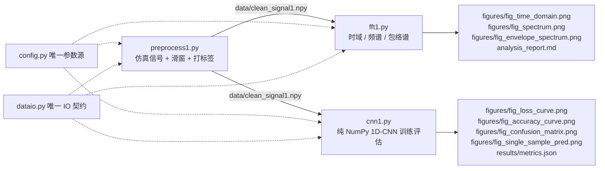
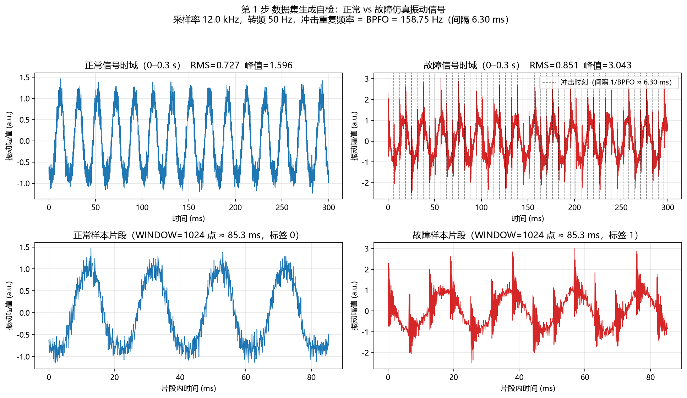
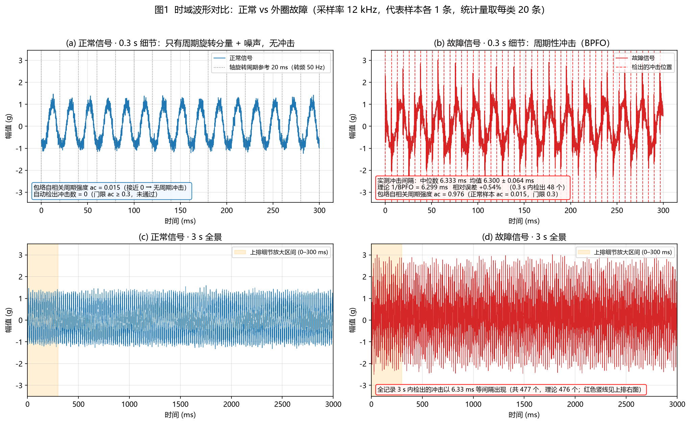
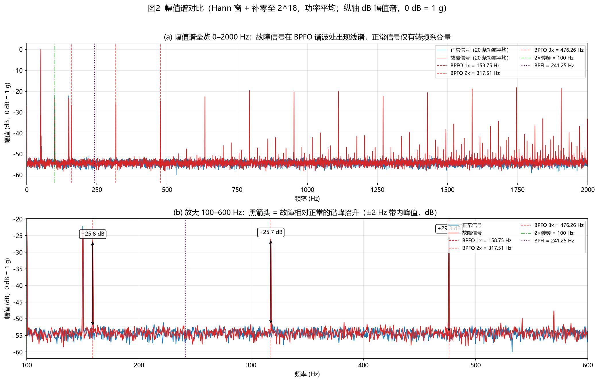
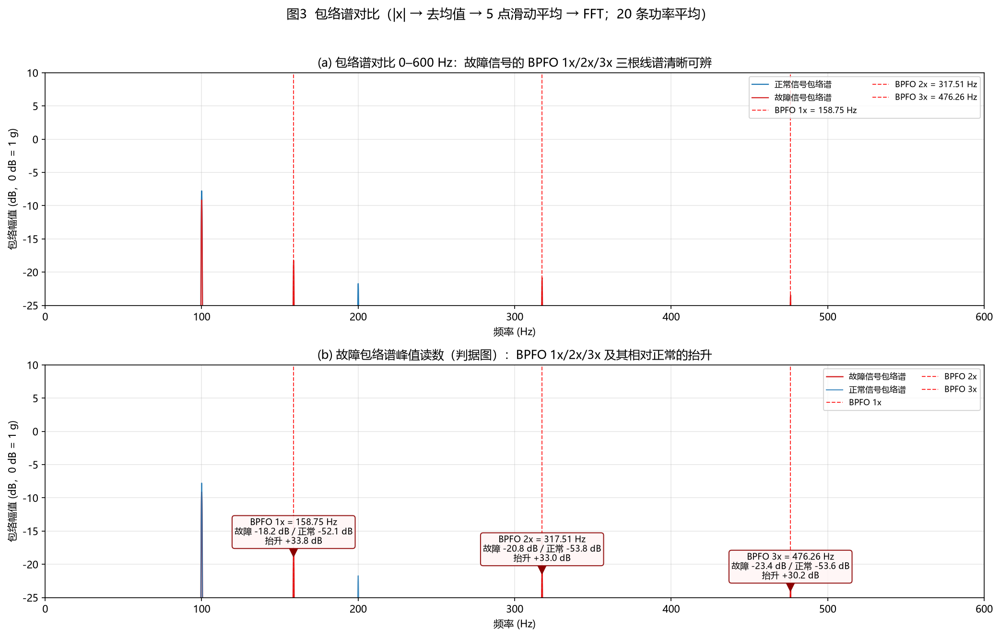
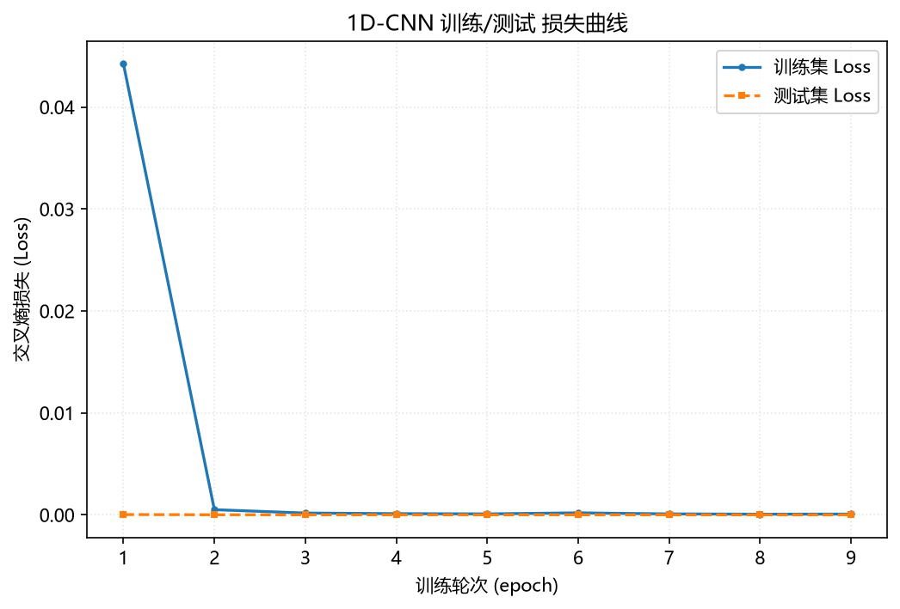
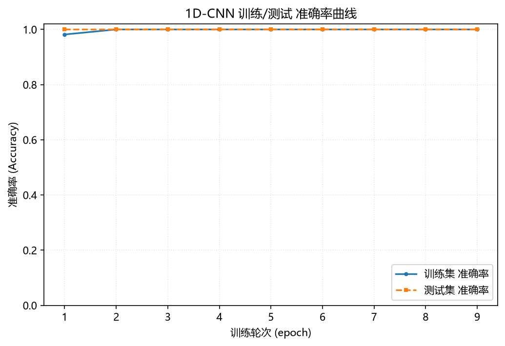
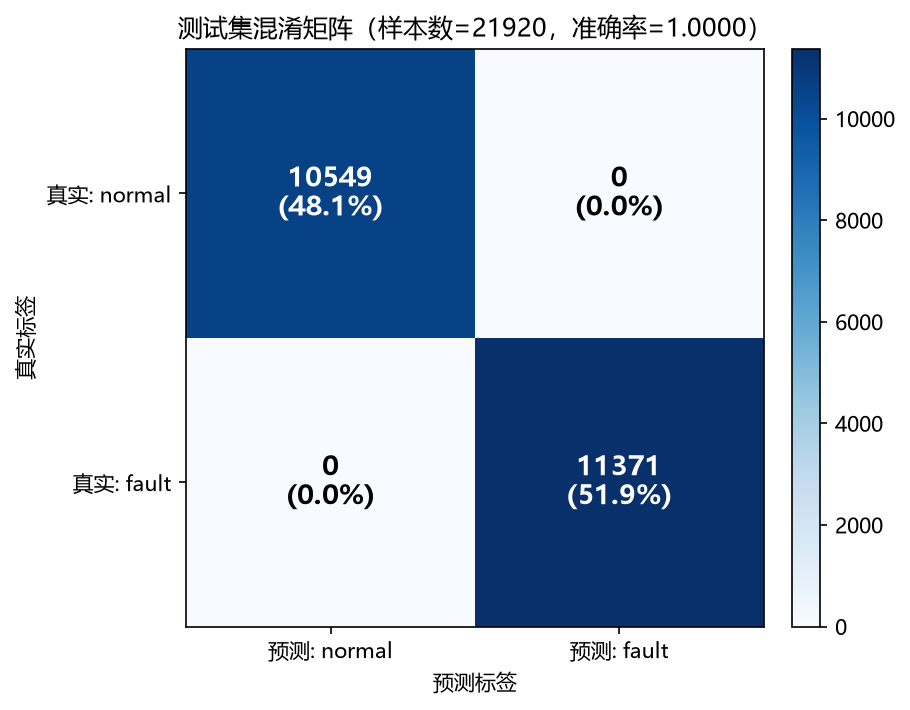
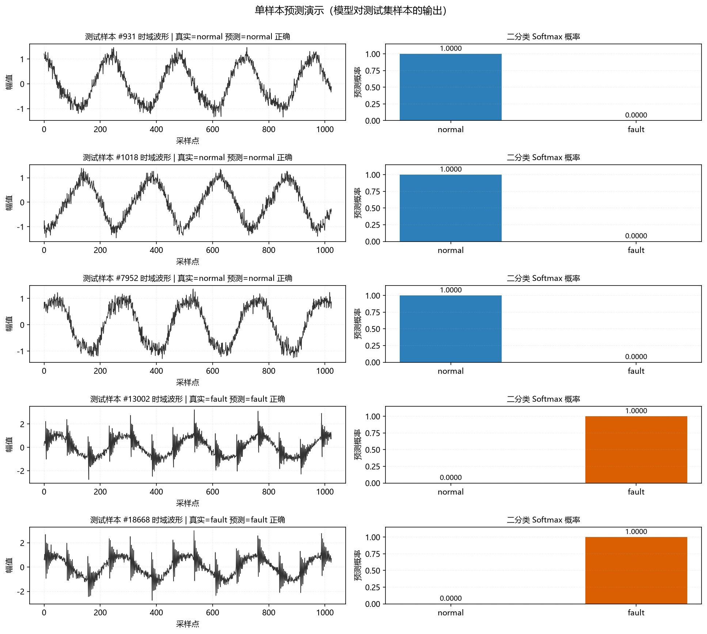

# 机械设备故障诊断技能 —— 三步流水线（教学项目）

> 对应一张教学幻灯片：标题「机械设备故障诊断技能」，流水线
> `preprocess1.py → fft1.py → cnn1.py`，分三步完成
> **数据集生成 → 信号时域/频域分析 → 1D-CNN 训练与评估**。
>
> 本仓库把幻灯片上的三段式作业升级为**可复现、可验收**的工程化教学流水线：
> 冻结配置与数据契约 → 三条脚本各自单一职责 → 全程带自检与量化指标 → 一键端到端验收。

**文档导航**

| 想知道什么 | 看哪份 |
|---|---|
| 快速上手、命令怎么敲、报错怎么办、产物怎么管、怎么发布到 GitHub | **[docs/RUNBOOK.md](docs/RUNBOOK.md)**（操作手册） |
| 项目为什么这么设计、信号机理、网络结构、结果与局限 | **[docs/PROJECT.md](docs/PROJECT.md)**（项目说明） |
| 参数速查、图索引、FAQ、进阶路线 | 本文（README） |
| 实施计划、决策记录、偏差登记、验收清单 | [PLAN.md](PLAN.md) |

---

## 1. 项目简介与三步流水线

```
┌──────────────────────┐   ┌────────────────────────┐   ┌───────────────────────────┐
│ 步骤 1               │   │ 步骤 2                 │   │ 步骤 3                    │
│ preprocess1.py       │──▶│ fft1.py                │──▶│ cnn1.py                   │
│                      │   │                        │   │                           │
│ · 仿真正常/故障信号   │   │ · 时域波形 + 统计量     │   │ · 按 seg_id 划分（防泄漏） │
│ · 滑窗 1024/步长 256  │   │ · FFT 幅值谱（BPFO）    │   │ · 纯 NumPy 1D-CNN 训练     │
│ · 打标签 0/1 + seg_id │   │ · 包络谱（关键判据）    │   │ · Loss/Acc 曲线 + 混淆矩阵 │
│                      │   │                        │   │ · 单样本预测演示           │
└──────────────────────┘   └────────────────────────┘   └───────────────────────────┘
        │                            │                            │
        ▼                            ▼                            ▼
 data/clean_signal1.npy      figures/fig_time_domain.png    figures/fig_loss_curve.png
 （约 540 MB，未入库）        figures/fig_spectrum.png       figures/fig_accuracy_curve.png
                             figures/fig_envelope_spectrum  figures/fig_confusion_matrix.png
                             + analysis_report.md           figures/fig_single_sample_pred.png
                                                            + results/metrics.json
        ▲                            ▲                            ▲
        └────────── config.py（唯一参数源） + dataio.py（唯一 IO 契约）───────────┘
```

mermaid 版本（GitHub / 支持 mermaid 的 Markdown 渲染器可直接显示）：



**三步之间用文件契约解耦**：第 1 步产出 `data/clean_signal1.npy`，第 2、3 步各自消费，
互不 `import` 对方。任何一步都能单独重跑、单独替换（例如把仿真信号换成真实轴承数据）。

**为什么先"造数据"再谈诊断**：真实轴承数据采集贵、标注贵，"正确答案"往往靠事后推断。
教学阶段先用**已知机理**的信号把闭环跑通 —— 我们事先知道冲击重复频率就是 `BPFO`
（外圈故障特征频率），于是第二步包络谱、第三步 CNN 的结论都有了"标准答案"，
可以反过来验证整条流水线的正确性。信号模型：

```
正常:  x(t) = Σ_h A_h·sin(2π·h·f_r·t + φ_h) + n(t)                h = 1,2,3，f_r = 50 Hz
故障:  x(t) = 正常成分 + Σ_k A_i·exp(-α·(t - k·T))·sin(2π·f_n·(t - k·T)) + n(t)

T = 1/BPFO ≈ 6.30 ms   冲击重复间隔（外圈滚过一处缺陷）
f_n ∈ [500, 4000] Hz   轴承座共振频率，**条内固定、条间随机**（模型无法"记频率"作弊）
α = 800 /s             冲击衰减快慢
n(t) ~ N(0, 0.15²)     测量噪声
```

---

## 2. 环境要求

### 2.1 解释器要求

只要满足下面两个条件，**任何** Python 3.9+ 解释器都可以：

| 条件 | 说明 |
|---|---|
| 已安装 `numpy` 与 `matplotlib` | 见 §2.2 的版本要求 |
| 用 `python tests/run_all.py` 时，它与子进程是**同一个**解释器 | `run_all.py` 用 `sys.executable` 调子进程，天然满足 |

```bash
# 先自检：确认当前解释器有 numpy / matplotlib
python -c "import numpy, matplotlib; print(numpy.__version__, matplotlib.__version__)"
```

本文档下方一切 `python` 都指**这个**通过自检的解释器。若同机存在多个 Python，
请用绝对路径或虚拟环境显式调用，例如：

```bash
# 方式一：直接用完整路径
/path/to/venv/bin/python tests/run_all.py          # Linux / macOS
C:\path\to\venv\Scripts\python.exe tests\run_all.py  # Windows

# 方式二：激活虚拟环境后再跑
source /path/to/venv/bin/activate     # Linux / macOS
C:\path\to\venv\Scripts\activate      # Windows PowerShell
python tests/run_all.py
```

| 项 | 本仓库验证时所用版本 | 来源 |
|---|---|---|
| Python | 3.12.14 | 解释器自身 |
| numpy | 2.3.5 | `import numpy` |
| matplotlib | 3.11.2 | `import matplotlib` |

> ⚠️ 若 `python -c "import numpy"` 报 `ModuleNotFoundError`，说明你选到了一个没装
> numpy 的解释器（同机存在多个 Python 时的常见现象）。请改用通过上面自检的那个。

### 2.2 依赖边界（**本项目刻意只依赖 numpy**）

| 包 | 是否需要 | 说明 |
|---|---|---|
| numpy | ✅ 必需（验证版本 2.3.5） | 全部数值计算 / FFT / 手写神经网络 |
| matplotlib | ✅ 必需（验证版本 3.11.2） | 8 张结果图，使用 `Agg` 无 GUI 后端 |
| torch / tensorflow | ❌ 不依赖 | `nn1d/` 是**纯 NumPy 手写**的 1D-CNN（前向 + 反向 + Adam 全部自己实现） |
| scipy | ❌ 不依赖 | 解析信号包络用 `np.fft` 自建，包络平滑一律 `np.convolve` |
| scikit-learn | ❌ 不依赖 | 混淆矩阵 / P-R-F1 由 `nn1d/model.py` 自行实现 |
| pytest | ❌ 不依赖 | 两个测试脚本自带 `if __name__ == "__main__"` 入口，直接 `python tests/xxx.py` 即可 |
| pandas / Pillow | ❌ 不依赖 | 流水线代码不使用 |

本仓库的依赖边界：只需 `numpy` 与 `matplotlib`（见 [`requirements.txt`](requirements.txt)），
无 torch / tensorflow / scipy / scikit-learn / pytest —— `nn1d/` 是纯 NumPy 手写实现，
数值计算与 FFT 全部走 numpy，包络平滑用 `np.convolve`，混淆矩阵与 P-R-F1 自行实现。
完整依赖清单见 [`requirements.txt`](requirements.txt)。

### 2.3 硬件与磁盘

- 磁盘：`data/clean_signal1.npy` 约 **540 MB**，生成过程中另需余量，建议留 **1.5 GB** 空闲。
- 内存：`cnn1.py` 峰值常驻约 **1.5 GB**（`X` = 109600 × 1024 float32 ≈ 449 MB）。
- 无需 GPU、无需联网。

---

## 3. 快速开始

```bash
# 进入项目根目录
cd mech-fault-diagnosis

# python 指 §2.1 中通过 numpy/matplotlib 自检的那个解释器
# 步骤 1：生成数据集（实测约 8–10 s，见 §3.1）
python preprocess1.py

# 步骤 2：时域 / 频谱 / 包络谱分析（实测约 3.5 s）
python fft1.py

# 步骤 3：1D-CNN 训练与评估（canonical 默认约 4–5 分钟）
python cnn1.py

# 一键跑通全部 5 个环节（3 条脚本 + 2 个自检脚本），输出 PASS/FAIL 汇总表
python tests/run_all.py
```

`cnn1.py` 可选参数（**只影响训练规模，不改 `config.py`**）：

```bash
python cnn1.py --epochs 20                 # 覆盖 config.EPOCHS
python cnn1.py --lr 1e-3 --batch-size 32   # 覆盖 config.LR / BATCH_SIZE
python cnn1.py --steps-per-epoch 60        # 每轮只走 60 个 batch（部分轮）
python cnn1.py --time-budget 600           # 训练循环累计耗时上限（秒）
python cnn1.py --full-epoch                # 关闭部分轮，每轮跑完整 87680 窗口（约 212 s/轮，仅供对照）
python cnn1.py --data path/to/other.npy    # 换数据集
```

> ⚠️ **副作用提醒**：`cnn1.py` 每次运行都会**无条件覆写** `results/metrics.json` 与 4 张训练图
> （`fig_loss_curve.png` / `fig_accuracy_curve.png` / `fig_confusion_matrix.png` /
> `fig_single_sample_pred.png`）。因此**不要**用 `--steps-per-epoch 1` 之类的调参档随手动文件——
> 仓库里的 canonical 产物会被那次"实验跑"的结果覆盖（例如只走 1 步/轮时模型尚未收敛，
> 混淆矩阵会变成全预测一类、准确率掉到 ~0.52），而 README 的表格仍写的是 canonical 默认值。
> 想试参数请先把 canonical 产物备份，或跑完后再执行一次裸 `python cnn1.py` 还原
> （固定 `SEED=42`，数值结果逐位可复现，仅墙钟耗时浮动）。

### 3.1 实测耗时（本机）

「单独跑」与「`run_all.py` 内」两列都是本机实测值：

| 环节 | 典型单跑耗时 | 典型 `run_all.py` 内耗时 | 说明 |
|---|---|---|---|
| `preprocess1.py` | **7–10 s** | **7–9 s** | 含 800 条信号生成、滑窗、落盘、4 项自检、画图 |
| `fft1.py` | **3–4 s** | **3–4 s** | 含 3 张图与 `analysis_report.md` 生成 |
| `cnn1.py`（canonical 默认） | **约 246–351 s** | **约 247–290 s** | 9 轮训练（第 9 轮早停）+ 全部测试集评估 + 出图；训练本身约 217–312 s |
| `tests/test_preprocess.py` | **6–7 s** | **6–7 s** | 14 项全部通过 |
| `tests/test_nn1d.py` | **3.6–4.3 s** | **3.6–4.1 s** | 15 项全部通过 |
| **`tests/run_all.py` 合计** | — | **约 266–314 s ≈ 4.4–5.2 分钟** | 退出码 **0**，汇总表 **5/5 PASS**；慢机器/首次冷启动可能到 10 分钟以上 |

> 上表是**典型区间**（多次实测），不是某一次的精确秒数：墙钟耗时随机器负载浮动。
> 需要某次运行的精确值，请读 `results/metrics.json` 的 `training_info` / `timing`
> （该文件由最近一次 `cnn1.py` 运行写出）。**软件/数据/模型相关数值不受浮动影响**（见 §3.2）。

### 3.2 关于「部分轮」（本项目的关键工程妥协，务必读完）

数据集有 **87680** 个训练窗口，完整一轮 = **1370 步**（batch 64），
纯 NumPy float32 下单步约 143.5 ms ⇒ **完整一轮 ≈ 212 s**，`config.py` 的 `EPOCHS=40`
需要 **2 小时以上**。

但幻灯片第 3 步要求产出 **Loss / Accuracy 曲线**（不是单点），一小时只跑出 1–2 个点画不成曲线。
于是 `cnn1.py` 在 **CLI 层**（脚本级常量，**没有改 `config.py` 一个超参**）提供：

| 控制项 | 默认值 | 位置 |
|---|---|---|
| `--steps-per-epoch` | `DEFAULT_STEPS_PER_EPOCH = 90` | `cnn1.py:94` |
| `--time-budget` | `DEFAULT_TIME_BUDGET = 900.0` s | `cnn1.py:95` |
| `--full-epoch` | 关闭部分轮与时间预算 | `cnn1.py:368-370` |

canonical 档位每轮只走打乱后的前 90 个 batch = **5760 个窗口/轮**（完整轮为 87680 个）。
`--time-budget 900` 是硬兜底：即使机器慢 3 倍，也会在预算处停下并保留真实 history。

**实测（本机，`python cnn1.py` canonical 默认，七次代表性运行）**：

| 指标 | 第 1 次（单独跑） | 第 2 次（单独跑） | 第 3 次（`run_all.py`） | 第 4 次（GBK 回归复验） | 第 5 次（`run_all.py`） | 第 6 次（产物还原） | 第 7 次（推送前验收） |
|---|---|---|---|---|---|---|---|
| `epochs_run` / `early_stopped` | 9 / true | 9 / true | 9 / true | 9 / true | 9 / true | 9 / true | 9 / true |
| 单轮平均耗时 | 27.37 s | 27.16 s | 26.09 s | 34.68 s | 28.30 s | 25.42 s | **24.09 s** |
| 训练总耗时 | 246.32 s | 244.48 s | 234.77 s | 312.13 s | 254.67 s | 228.82 s | **216.78 s** |
| 脚本总耗时 | 283.79 s | 280.33 s | 266.42 s | 350.60 s | 289.41 s | 261.12 s | **246.57 s** |
| `test_accuracy` | 1.0 | 1.0 | 1.0 | 1.0 | 1.0 | 1.0 | 1.0 |
| 混淆矩阵 | `[[10549, 0], [0, 11371]]` | `[[10549, 0], [0, 11371]]` | `[[10549, 0], [0, 11371]]` | `[[10549, 0], [0, 11371]]` | `[[10549, 0], [0, 11371]]` | `[[10549, 0], [0, 11371]]` | `[[10549, 0], [0, 11371]]` |

多次运行的**数值结果逐位一致**（`config.SEED=42` 固定：`train_loss[0]=0.04422906536411675`、
`test_loss[-1]=4.81475850047389e-07`、`lr[1]=0.00291`、`grad_norm[0]=0.15751730610730283`、
逐轮 `test_acc` 全为 1.0），**只有墙钟耗时**因机器负载而浮动（单轮 23.2–34.7 s）。
第 4 次是在**同一台机器并行跑其他任务**时测量的，故耗时明显偏高（34.68 s/轮），
但它同时是**在 GBK 重定向（无真实控制台）下**完成的 —— 退出码 0，证明 §8 Q1 的编码修复有效。
本仓库 `results/metrics.json` 中保存的是**第 7 次（推送前最终验收，最新一次）**运行的耗时。

> **部分轮的准确含义**：它意味着 **1 个 epoch 不等于扫完整个训练集**
> （只看了 5760 / 87680 个窗口）。它只减少"每轮看多少数据"，
> **不改**网络结构、损失函数、优化器、学习率调度或数据划分语义；
> `--full-epoch` 可切回教科书意义上的完整轮。
> 如实披露这一点，比把"9 轮"说成"训练了 9 遍全量数据"更重要。

---

## 4. 目录结构

```
mech-fault-diagnosis/
├── README.md                     # 本文件
├── PLAN.md                       # 方案与验收基线 + 偏差登记（Deviation Log）
├── docs/
│   ├── RUNBOOK.md                # 操作手册：SOP / 排障 / 产物管理 / 发布流程
│   └── PROJECT.md                # 项目说明：架构 / 信号机理 / 网络结构 / 结果与局限
├── requirements.txt              # 依赖清单（仅 numpy / matplotlib）
├── .gitignore                    # 忽略 data/*.npy、__pycache__；保留 figures/*.png、results/metrics.json
├── config.py                     # [冻结] 唯一参数源 + 路径常量 + 绘图风格 + config/config_bp/bp 别名
├── dataio.py                     # [冻结] 数据集契约：save/load/validate/split_by_segment/save_metrics
├── preprocess1.py                # 步骤 1：仿真信号 + 滑窗 + 打标签（688 行）
├── fft1.py                       # 步骤 2：时域 / 频谱 / 包络谱（917 行）
├── cnn1.py                       # 步骤 3：1D-CNN 训练与评估（678 行）
├── analysis_report.md            # 步骤 2 产出：量化分析报告（94 行）
├── nn1d/                         # 纯 NumPy 手写神经网络内核
│   ├── __init__.py               # 包导出（版本 1.0.0）
│   ├── grad.py                   # im2col/col2im、softmax-CE、范数裁剪、数值梯度、迷你自动微分 Var
│   ├── layers.py                 # Conv1d / BatchNorm1d / ReLU / MaxPool1d / GlobalAvgPool1d / Dropout / Linear / Adam
│   └── model.py                  # CNN1D 组装、train_model、evaluate、confusion_matrix、classification_report
├── data/
│   ├── clean_signal1.npy         # 数据集（约 540 MB，可重新生成，**不入库**）
│   └── raw/                      # 预留的原始数据目录（当前为空）
├── figures/                      # 8 张结果图（**全部入库**）
│   ├── fig_preprocess_cache.png
│   ├── fig_time_domain.png
│   ├── fig_spectrum.png
│   ├── fig_envelope_spectrum.png
│   ├── fig_loss_curve.png
│   ├── fig_accuracy_curve.png
│   ├── fig_confusion_matrix.png
│   └── fig_single_sample_pred.png
├── results/
│   └── metrics.json              # 指标 + 配置快照 + 环境信息（**入库**，可追溯）
└── tests/
    ├── run_all.py                # 一键验收（3 条脚本 + 2 个自检）
    ├── test_preprocess.py        # 步骤 1 自检 14 项
    └── test_nn1d.py              # nn1d 自检 15 项
```

`nn1d` 的设计红线（见 `nn1d/__init__.py:13-16`）：
1. 所有含参数模块的反向传播都必须通过中心差分数值梯度校验；
2. `BatchNorm` / `Dropout` 在 eval 下必须切到推理模式；
3. 权重衰减只施加于 Conv/Linear 的权重，不施加于 bias 与 BN 参数。

---

## 5. 数据集契约

文件：`data/clean_signal1.npy`，由 `np.save` 写出的一个 **dict**（在磁盘上是 0-d object array，
用 `dataio.load_dataset()` 读取会自动 `.item()` 还原为 dict，同时兼容 `.npz`）。

| 字段 | 形状 / 类型 | 含义 |
|---|---|---|
| `X` | `(109600, 1024)` float32 | 滑窗截取后的信号片段，**1D-CNN 输入**（第二维必须 == `config.WINDOW`） |
| `y` | `(109600,)` int64 | 标签：`0` = 正常（normal），`1` = 故障（fault） |
| `seg_id` | `(109600,)` int64 | 该窗口来自第几条原始信号（0..799），**防泄漏划分的依据** |
| `raw` | `(800, 36000)` float32 | 原始长信号，供步骤 2 做时域/频域分析 |
| `meta` | `dict` | 自描述元信息：`format_version`、`fs`、`window`、`stride`、`bpfo/bpfi/bsf/ftf`、`label_map`、`seed` 等 |

**数据量推导**：每条 3 s @ 12000 Hz = 36000 点；`1 + (36000 - 1024) // 256 = 137` 个窗口/条；
800 条（正常 400 + 故障 400）⇒ `800 × 137 = 109600` 个窗口。类别均衡，无需类别加权。

`meta` 关键字段实测值（`results/metrics.json` → `dataset.meta`）：

| 字段 | 值 |
|---|---|
| `format_version` | `"1.0"` |
| `fs` | 12000.0 |
| `window` / `stride` | 1024 / 256 |
| `n_windows_per_segment` | 137 |
| `n_segments` / `n_windows_total` | 800 / 109600 |
| `bpfo` / `bpfi` / `bsf` / `ftf` | 158.75324675324677 / 241.24675324675326 / 116.0658183126697 / 19.844155844155846 |
| `label_map` | `{"0": "normal", "1": "fault"}` |
| `segment_layout` | `raw[0:400]=normal(0), raw[400:800]=fault(1)` |
| `resonance_band_hz` | `[500.0, 4000.0]` |

**防泄漏约定**（`dataio.py:20-24`、`dataio.split_by_segment()`）：
X 的划分**不得**在窗口级别随机进行 —— 相邻滑窗重叠 75%，随机划分会让同一条信号的
重叠片段同时进训练集与测试集，准确率虚高到 99%+ 却毫无泛化能力。
必须**先按 `seg_id` 分组划分原始信号，再收集对应窗口**。实测划分结果：

| 集合 | 窗口数 | 信号条数 | 正常窗口 | 故障窗口 |
|---|---|---|---|---|
| 训练集 | 87680 | 640 | 44251 | 43429 |
| 测试集 | 21920 | 160 | 10549 | 11371 |

`dataio` **不做**标准化；标准化统计量只从训练集拟合（`cnn1.py:133-205` 的
`fit_normalizer()` / `apply_normalizer()` / `load_and_split()`，`source: "train_only"`，
实测 `mean=0.013106644101273775`、`std=0.7909614064964641`）。

---

## 6. 关键参数表（逐条抄自 `config.py`）

| 常量 | 值 | 含义 | `config.py` 行号 |
|---|---|---|---|
| `FUNC_F` | 50.0 | 转频（Hz），电机/轴旋转基频 | `config.py:34` |
| `FS` | 12000.0 | 采样频率（Hz） | `config.py:35` |
| `T_PER_SAMPLE` | 3.0 | 单次采样时长（s） | `config.py:36` |
| `N_PER_SAMPLE` | 36000 | 每条信号点数（= `FS × T_PER_SAMPLE`） | `config.py:37` |
| `WINDOW` | 1024 | 滑动窗口长度（点），与 CNN 输入一致 | `config.py:38` |
| `STRIDE` | 256 | 滑动步长（点），75% 重叠 | `config.py:39` |
| `N_SAMPLES_PER_CLASS` | 400 | 每类信号条数 | `config.py:40` |
| `DATASET_NAME` | `"clean_signal1.npy"` | 数据集文件名 | `config.py:42` |
| `BEARING["n_balls"]` | 8 | 滚动体个数 | `config.py:65` |
| `BEARING["d_ball"]` | 7.94e-3 | 滚动体直径（m） | `config.py:66` |
| `BEARING["D_pitch"]` | 38.5e-3 | 节圆直径（m） | `config.py:67` |
| `BEARING["contact_deg"]` | 0.0 | 接触角（度） | `config.py:68` |
| `BPFO` | 158.75324675324677 | 外圈故障特征频率（Hz） | `config.py:71` |
| `BPFI` | 241.24675324675326 | 内圈故障特征频率（Hz） | `config.py:72` |
| `BSF` | 116.0658183126697 | 滚动体故障特征频率（Hz） | `config.py:73-75` |
| `FTF` | 19.844155844155846 | 保持架故障特征频率（Hz） | `config.py:76` |
| `IMPACT_FREQ_FAULT` | = `BPFO` | 故障冲击重复频率 | `config.py:79` |
| `IMPACT_FREQ_NORMAL` | = `FUNC_F` | 正常信号的"旋转"重复频率 | `config.py:80` |
| `FAULT_HARMONICS` | `(1, 2, 3)` | 早期局部缺陷典型谱峰阶次 | `config.py:82` |
| `AMP_ROT` | 1.0 | 转频分量幅度 | `config.py:87` |
| `AMP_NOISE` | 0.15 | 高斯白噪声标准差 | `config.py:88` |
| `AMP_IMPULSE` | 2.0 | 故障冲击幅度 | `config.py:89` |
| `IMPULSE_DECAY` | 800.0 | 冲击衰减时间常数（1/s） | `config.py:90` |
| `NORMAL_LABEL` / `FAULT_LABEL` | 0 / 1 | 标签约定 | `config.py:93-94` |
| `CLASS_NAMES` | `("normal", "fault")` | 类别名 | `config.py:95` |
| `SEED` | 42 | 全局随机种子 | `config.py:100` |
| `TRAIN_RATIO` | 0.8 | 按信号条数划分比例 | `config.py:101` |
| `EPOCHS` | 40 | 训练轮数上限 | `config.py:102` |
| `BATCH_SIZE` | 64 | 批大小 | `config.py:103` |
| `LR` | 3e-3 | 初始学习率 | `config.py:104` |
| `LR_DECAY` | 0.97 | 每轮学习率衰减系数 | `config.py:105` |
| `LR_MIN` | 1e-5 | 学习率下限 | `config.py:106` |
| `WEIGHT_DECAY` | 1e-4 | L2 权重衰减 | `config.py:107` |
| `L2_EPS` | 1e-8 | 防除零（标准化 / L2） | `config.py:108` |
| `GRAD_CLIP` | 5.0 | 全局梯度范数裁剪阈值 | `config.py:109` |
| `DROPOUT` | 0.3 | Dropout 比例 | `config.py:110` |
| `DROPOUT_SEED_OFFSET` | 1000 | dropout 随机流与 shuffle 解耦 | `config.py:111` |
| `INPUT_LEN` | = `WINDOW` = 1024 | CNN 输入维度 | `config.py:112` |
| `NUM_CLASSES` | 2 | 类别数 | `config.py:113` |
| `EARLY_STOP_PATIENCE` | 8 | 验证准确率连续 N 轮不提升即早停 | `config.py:114` |
| `N_FILTERS` | `(16, 32, 64)` | 三层卷积通道数 | `config.py:115` |
| `KERNEL_SIZES` | `(9, 7, 5)` | 三层卷积核长度 | `config.py:116` |
| `POOL_SIZE` | 2 | 最大池化窗口 | `config.py:117` |
| `HIDDEN_DIM` | 64 | 全连接隐层维度 | `config.py:118` |
| `N_DEMO_SAMPLES` | 5 | 单样本预测演示条数 | `config.py:119` |
| `PLOT_DPI` | 150 | 出图 DPI | `config.py:131` |
| `FONT_CANDIDATES` | `("Microsoft YaHei", "SimHei", "Noto Sans CJK SC", "Source Han Sans SC", "Arial Unicode MS")` | 中文字体候选 | `config.py:132-135` |

### 6.1 脚本级常量（**不在 `config.py` 里**，见 `cnn1.py:85-95`）

| 常量 | 值 | `cnn1.py` 行号 |
|---|---|---|
| `DEFAULT_STEPS_PER_EPOCH` | 90 | `cnn1.py:94` |
| `DEFAULT_TIME_BUDGET` | 900.0 | `cnn1.py:95` |

### 6.2 网络结构（`nn1d/model.py` 组装，超参全部来自 `config.py`）

```
输入 (B, 1, 1024)
  Conv1d(1→16,  k=9) → BN → ReLU → MaxPool(2)     1024 → 512
  Conv1d(16→32, k=7) → BN → ReLU → MaxPool(2)      512 → 256
  Conv1d(32→64, k=5) → BN → ReLU → MaxPool(2)      256 → 128
  GlobalAvgPool → Dropout(0.3) → Linear(64→64) → ReLU → Dropout(0.3) → Linear(64→2)
```

`trainable_params = 18594`（运行时统计 = 理论手算 = 参数清单求和，`cnn1.py:446-448` 断言校验通过）。

---

## 7. 结果图索引（8 张，相对路径可直接预览）

### 步骤 1（`preprocess1.py`）

**图 1 · `figures/fig_preprocess_cache.png`** —— 数据集生成自检：正常/故障原始信号时域对比（0–0.3 s）
与两类滑窗样本片段（`WINDOW=1024` 点 ≈ 85.3 ms），红色竖线标出真实冲击时刻。



### 步骤 2（`fft1.py`）

**图 2 · `figures/fig_time_domain.png`** —— 时域波形对比（采样率 12 kHz，转频 50 Hz）：
(a)(b) 0.3 s 细节（正常只有周期旋转分量 + 噪声，故障有周期冲击）、(c)(d) 3 s 全景。



**图 3 · `figures/fig_spectrum.png`** —— 幅值谱对比（Hann 窗 + 补零至 2^18，功率平均，纵轴 dB 幅值谱，
0 dB = 1 g）：故障在 BPFO 1x/2x/3x 处相对正常抬升 **+25.8 / +25.7 / +29.3 dB**。



**图 4 · `figures/fig_envelope_spectrum.png`** —— 包络谱对比（`|x|` → 去均值 → 滑动平均 → FFT），
**轴承故障的直接判据图**：BPFO 1x/2x/3x 抬升 **+33.8 / +33.0 / +30.2 dB**，三根线谱在 0–600 Hz 内清晰可辨。



> 数值、图、结论三者同源的完整分析见 [`analysis_report.md`](analysis_report.md)。

### 步骤 3（`cnn1.py`）

**图 5 · `figures/fig_loss_curve.png`** —— 1D-CNN 训练/测试损失曲线（9 轮真实 history）。



**图 6 · `figures/fig_accuracy_curve.png`** —— 1D-CNN 训练/测试准确率曲线（训练集第 2 轮起 1.0，测试集全程 1.0）。



**图 7 · `figures/fig_confusion_matrix.png`** —— 测试集混淆矩阵，
`[[10549, 0], [0, 11371]]`，四格之和 21920 = 测试样本数，由混淆矩阵反算准确率与 `test_accuracy` 一致。



**图 8 · `figures/fig_single_sample_pred.png`** —— 单样本预测演示：抽 5 条测试样本，显示波形与二分类 Softmax 概率。



### 训练结果摘要（`results/metrics.json`，canonical 默认档）

| 指标 | 值 |
|---|---|
| `test_accuracy` | **1.0** |
| `test_loss` | 4.81475850047389e-07 |
| 混淆矩阵 | `[[10549, 0], [0, 11371]]` |
| 每类 precision / recall / f1 | normal 1.0 / 1.0 / 1.0；fault 1.0 / 1.0 / 1.0 |
| `trainable_params` | 18594（= `trainable_params_manual`，`trainable_params_match_manual: true`） |
| `epochs_run` | 9（第 9 轮早停，`early_stopped: true`） |
| 单轮平均耗时 | 40 轮中实际跑了 9 轮，均值 **24.4–34.7 s/轮**（随机器负载浮动；精确值见 `metrics.json` 的 `training_info.mean_epoch_seconds`） |
| 训练总耗时 | **约 229–312 s**（同上，精确值见 `training_info.total_seconds`） |
| 脚本总耗时 | **约 261–351 s**（同上，精确值见 `timing.script_total_seconds`） |
| 复现命令 | `python cnn1.py` |

> 上表**软件/数据/模型**相关数值与 `results/metrics.json` 当前内容逐项一致（该文件由最近一次
> 裸 `python cnn1.py` 写出）：`test_accuracy`、`test_loss`、混淆矩阵、`trainable_params`、
> `epochs_run` 在固定 `SEED=42` 下**逐位可复现**。仅**墙钟耗时**三项随机器负载浮动，
> 故此处给出实测区间而非某一台的精确秒数——需要精确值请直接读该文件。
> 软件/数据版本：Python 3.12.14、numpy 2.3.5、matplotlib 3.11.2。

---

## 8. 常见问题（FAQ）

**Q1. 图中中文变成方框 / 乱码怎么办？**
出图统一走 `config.configure_matplotlib()`：先 `matplotlib.use("Agg")`（无 GUI 后端），
再从 `FONT_CANDIDATES` 里挑**实际存在**的字体，最后回退 `DejaVu Sans`。
本机实测命中 `['Microsoft YaHei', 'SimHei']`，中文正常。
若你的机器没有这些字体，请安装任一中文字体或把可用字体名加到 `config.py:132-135` 的候选列表。
另外控制台中文乱码是另一件事：Windows 在 **stdout 被重定向（无真实控制台）** 时按
locale 编码，中文系统即 GBK。此时遇到非 GBK 字符（如 `√`）会直接抛
`UnicodeEncodeError` 并以**退出码 1** 结束——CI、`> log`、`| tee` 场景全中。
因此所有含中文输出的入口内部都调用
`stream.reconfigure(encoding="utf-8", errors="replace")`：
`preprocess1.py`、`fft1.py`、`cnn1.py`、`tests/test_nn1d.py`、`tests/run_all.py`，
所以无论直接跑还是重定向都不会乱码；`tests/run_all.py` 另外给所有子进程注入
`PYTHONUTF8=1`，双重保险。
`tests/test_preprocess.py` 自身没有守卫，但它 `import preprocess1`，会**顺带**被
`preprocess1.py` 模块级的 `_force_utf8_stdout()` 改好 stdout（传递性副作用，能工作但不是设计）。
若你自建新脚本，请显式加上同样的守卫，不要依赖这种副作用。

**Q2. 报 `ModuleNotFoundError: No module named 'numpy'`？**
解释器选错了——同机上存在多个 Python，你启动的那个没装 numpy。
请改用 §2.1 中通过自检的解释器（用绝对路径或先激活虚拟环境，写法见 §2.1）。
`tests/run_all.py` 用 `sys.executable` 调子进程，只要用它自己启动就不会串解释器。

**Q3. 报 `FileNotFoundError: 数据集不存在 ... 请先运行: python preprocess1.py`？**
先跑 `python preprocess1.py`。注意步骤 2、3 都消费 `data/clean_signal1.npy`，
且工作目录必须是项目根目录（脚本用 `config.ROOT` 拼绝对路径，所以从别处跑也不会找错，
但相对路径的 `--data` 参数会按当前工作目录解析）。

**Q4. 内存不够 / `MemoryError`？**
`data/clean_signal1.npy` 约 540 MB，`cnn1.py` 峰值常驻约 1.5 GB。关掉占内存的程序；
或先用 `cnn1.py --steps-per-epoch 30` 降低每轮规模（不减少数据加载内存）。

**Q5. 测试准确率 1.0，是不是假的 / 过拟合了？附——为什么这么高？**
**不是泄漏，但也不是"模型很强"**。原因是三条，缺一不可：
1. 数据是**机理仿真的合成信号**（转频 + 高斯噪声 + 周期冲击），类间差异明显、任务本身线性可分性强；
2. 划分**按 `seg_id` 分组**（`dataio.split_by_segment`），同一条信号的重叠窗口只出现在一侧，
   已在 `preprocess1.py` 步骤 4(b) 与 `tests/test_preprocess.py` 中断言校验 —— **没有窗口级泄漏**；
3. `analysis_report.md` 显示的物理差异本身很大（RMS 1.17×、峭度 1.60×、BPFO 谐波 +25.8 dB 起）。

因此 `test_accuracy = 1.0` 是**预期结果**，它证明的是**流水线正确**（数据→特征→模型→评估闭环自洽），
**不是算法能力强**。换 CWRU 等真实轴承数据，指标会明显下降（见 §9）。
`cnn1.py` 结尾也明确列出了本实验的 7 条已知局限。

**Q6. 跑得很慢 / 想快点看到结果？**
最慢的是 `cnn1.py`。canonical 默认已经是"部分轮 + 900 s 时间预算"的加速档位（约 4–5 分钟）。
再快可 `python cnn1.py --steps-per-epoch 30 --time-budget 300`，但曲线点数会变少。
**不要**去改 `config.py` 的网络超参来提速 —— `config.py` / `dataio.py` 是冻结契约文件。

**Q7. 为什么没有 `pip install -r requirements.txt` 也能跑？**
因为本仓库验证时所用解释器已预装 numpy 与 matplotlib；
`requirements.txt` 只用于记录依赖边界（在你自己的机器上正常 `pip install` 即可）。

**Q8. 为什么没有用 pytest 跑测试？**
环境未安装 pytest。两个测试脚本自带 `if __name__ == "__main__"` 入口，
打印 `[PASS]/[FAIL]` 并返回退出码 0/1，`tests/run_all.py` 正是靠退出码汇总。

> ✅ **历史缺陷（已修）**：`tests/test_nn1d.py` 汇总行曾打印 `✅`（U+2705）——该字符
> **无法用 GBK 编码**。在 Windows 默认 GBK 控制台里**直接**执行
> `<python> tests/test_nn1d.py`，15 项测试实际全部通过，但汇总行会抛
> `UnicodeEncodeError: 'gbk' codec can't encode character '\u2705'`，进程以退出码 1 结束。
> 这类问题同样存在于 `cnn1.py`（其进度行含 `✔`/`✘` 等非 GBK 字符）。
>
> 修复方式（两道防线，二者独立即可生效）：
> 1. 真正会崩的两个入口 `cnn1.py` 与 `tests/test_nn1d.py` 在模块开头调用
>    `stream.reconfigure(encoding="utf-8", errors="replace")`
>    （`preprocess1.py`/`fft1.py`/`tests/run_all.py` 本就有同类守卫）；
> 2. 源码内所有非 GBK 字形（`✅`/`✓`/`✔`/`✘`/`⊆`/`²` 等）替换为 GBK 可编码的等价字符
>    （`√`/`×` 等）。
>
> 复核命令：`python -c "print('√')"` 重定向到文件后退出码应为 0；实测 `cnn1.py` 与
> `tests/test_nn1d.py` 在 `PYTHONIOENCODING=gbk` + 重定向下均 **EXIT=0**
> （`tests/test_preprocess.py` 同条件下亦为 0，但它自身未加守卫，靠 `import preprocess1`
> 的传递性副作用，见 Q1）。

**Q9. 想只跑某一步？**
`tests/run_all.py` 会顺序跑全部 5 个环节；单独跑直接执行对应脚本即可，例如
`preprocess1.py`、`fft1.py`、`cnn1.py`、`tests/test_preprocess.py`、`tests/test_nn1d.py`。
五个环节均可直接单独执行，无需额外设置环境变量（UTF-8 输出已由各脚本自身的守卫保证，
`tests/test_preprocess.py` 例外，它靠 `import preprocess1` 的传递性副作用，见 Q1/Q8）。

---

## 9. 进阶方向

| 阶段 | 动作 | 预期收益 |
|---|---|---|
| P1 | **换真实数据**：CWRU / Paderborn / 自采数据集 | 暴露合成数据掩盖的问题（域偏移、类别不均衡、标注噪声） |
| P2 | **加噪鲁棒性矩阵**：SNR 从 −5 到 +20 dB 扫描，画"准确率–信噪比"曲线 | 得到工程可用的性能边界，而不是单点指标 |
| P3 | **输入形式消融**：原始时域 vs FFT 幅值谱 vs 包络谱作为 CNN 输入 | 量化"手工特征工程 vs 端到端"的收益 |
| P4 | **变工况域自适应**：DANN / CORAL 等 | 解决"换转速/换负载即失效"的问题 |
| P5 | **可解释性**：Grad-CAM 映射回时域波形，看模型关注冲击还是别处 | 让结论可被现场工程师采信 |
| P6 | **边缘部署**：参数量 < 10 万的模型量化后上 MCU | 让"诊断技能"落到设备端，而非停留在实验室 |
| P7 | **从分类到剩余寿命预测（RUL）** | 从"有没有故障"升级到"还能用多久" |

工程层面的下一步建议：
- 把 `nn1d` 的卷积换成 im2col + GEMM 缓存友好实现，或引入 `numpy` 广播优化，压缩单轮耗时；
- 增加**验证集**（当前早停监控量用的是测试集准确率，是教学简化，`cnn1.py:664` 已如实披露）；
- 归一化统计量从"全局单通道标量"改为逐通道统计，为多通道（三向加速度计）做准备。

---

## 附：已知局限（来自 `cnn1.py` 结尾的自述）

1. 数据是**机理仿真的合成信号**，过于规整、类间差异明显，准确率接近 100% 属预期结果，不能当作真实工程性能。
2. 换成真实轴承/齿轮箱数据（强背景噪声、变转速、多故障耦合、类别不均衡）时准确率会显著下降。
3. 滑动窗口来自同一条信号，窗口间高度相关；虽然按 `seg_id` 划分已阻断泄漏，但样本量仍被高估，统计置信区间比看起来更宽。
4. 早停的监控量用的是**测试集**准确率（教学简化），严格做法应另留验证集。
5. 归一化统计量为全局单通道标量；真实数据若各通道量纲差异大，应改为逐通道统计。
6. 网络是朴素全卷积 + 全连接，没有残差、注意力或频域特征融合。
7. canonical 档位使用**部分轮**（每轮只看打乱后前 5760 个窗口，完整轮为 87680 个），因此"一轮"不等于扫过整个训练集。
